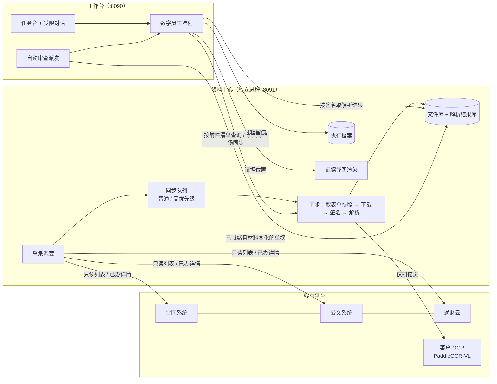

# 资料中心与自动化工作流设计

> 版本：2026-11-09　｜　依据：2026-11-09 需求对齐（见第 10 节决策表）、`文件解析结果缓存与存储设计.md`（数据模型沿用）
> 范围：四个数字员工共用的「资料中心」独立服务、定时采集与当场同步、客户 OCR 对接、执行档案、自动审查与任务台、受限对话。

## 1. 目标与边界

| 目标 | 说明 |
|---|---|
| 数字员工 = 自动化工作流 | 每个数字员工是一条确定的流程（取单 → 资料 → 规则 → 模型评估 → 报告）。大模型只在流程中做「需要人判断的评估」，并且必须引用原文、回原文校验 |
| 对话只是任务入口 | 只接受能执行的任务和报告追问；不闲聊，其他输入引导回任务 |
| 资料提前就绪 | 资料中心定期到客户平台找到待审单据所需文件，提前下载、签名、解析入库；审查时按签名直接取解析结果 |
| 减轻客户 OCR 压力 | 同一内容只解析一次；只有扫描件 / 图片调用客户 OCR，文字层 PDF 与 Office 文件直接读取 |
| 全程可追溯 | 每次执行的表单快照、接口原始报文（脱敏）、文件签名与解析版本、模型完整输入输出、规则结论、证据截图都入档 |

不变的约束：四个场景统一**只读**，不审批、不退回、不写客户系统（报销也不写通财云意见框）；采购员工的规则与结论不因本次改造而变化（离线重放回归必须逐条一致）。

## 2. 总体结构



- **资料中心**负责「文件是什么、解析出了什么、每次执行做了什么」；它**不判断**附件清单是否最新。
- **数字员工**每次审查都实时读取表单（1–2 秒）拿到当前附件清单，再按清单到资料中心逐个取；命中直接用，缺失则请资料中心**当场同步**（高优先级插队），前端给出提示与进度。
- 两个进程只通过 HTTP 接口交互。开发与测试时可用「进程内客户端」直接调用同一套服务代码（接口一致），部署时设置 `DE_RC_URL` 切到 HTTP。

## 3. 资料中心

### 3.1 数据（在既有表结构上扩展，SQLite，表结构按可迁移 PostgreSQL 设计）

独立库文件 `.runtime/resource/resource.sqlite3`（`DE_RC_DB_PATH` 可配）；原件与解析结果目录沿用 `.runtime/store/blobs`、`parsed`（按签名寻址，路径规则不变）。首次启动时把旧库中的文件与解析记录一次性迁入，已有的 OCR 结果不会重做。

| 表 | 内容 | 状态 |
|---|---|---|
| `file_blob` / `file_occurrence` / `file_meta` | 原件、出处（来源系统、单号、字段、客户文件 id、版本、文件名、上传时间、密级）、文档属性 | 沿用 |
| `parse_result` / `parse_page` | 解析结果索引与逐页文字；处理键含解析引擎与版本，换引擎不会混用旧结果 | 沿用，参数中加入引擎 |
| `request_snapshot` | 每次同步时的表单快照：字段、附件清单、材料指纹、员工归属、来源列表（待办/已办）、标题 | 新增 |
| `sync_job` | 同步任务：单号、优先级、触发方（采集 / 审查当场）、状态、进度（文件数、OCR 页数）、错误、重试次数 | 新增 |
| `collect_round` | 每轮采集：来源、开始结束、扫描单据数、新增 / 变化 / 失败数 | 新增 |
| `archive_run` / `archive_item` / `archive_shot` | 执行档案：每次执行一条、过程条目（按序）、证据截图 | 新增 |

### 3.2 材料指纹

`material_fp = SHA-256(按字段排序的 (字段, 客户文件 id, 版本, 文件名) 列表 + 表单字段 (标签, 显示值) 摘要)`。
只依赖表单与附件清单，不需要先下载；资料中心的快照与数字员工取单时用同一个函数计算，结果一致。
附件被替换（文件 id 或版本变化）或表单关键字段变化 → 指纹变化 → 触发自动重审。

### 3.3 接口

| 接口 | 用途 |
|---|---|
| `POST /v1/files/lookup` | 给定来源与附件清单，返回每个附件是否已入库（签名）、是否已解析、解析状态与页数、需要 OCR 的页数估计；不下载 |
| `POST /v1/files/ensure` | 给定附件清单，缺失的当场下载入库（高优先级），返回签名；附 `task_id` 时进度推到该任务 |
| `POST /v1/parse/ensure` | 给定签名列表，未解析的当场解析，返回解析状态；进度（第 n/m 页）可查询 |
| `GET /v1/parse/{sig}` | 取统一文档 JSON（读取时校验完整性签名） |
| `GET /v1/jobs/{job_id}` | 同步任务进度 |
| `POST /v1/requests/sync` | 同步一张单据：取表单快照 → 下载 → 解析（采集与手动触发共用） |
| `GET /v1/requests?employee=&ready=` | 已采集单据列表：标题、来源列表、资料状态（已就绪 / 部分 / 未同步）、材料指纹、最近同步时间 |
| `GET /v1/requests/{source}/{request_id}` | 单据快照与附件解析状态 |
| `GET /v1/collect/status` · `POST /v1/collect/run` | 采集状态、立即执行一轮 |
| `POST /v1/archive/{task_id}/start|items|finish` | 执行档案写入（批量） |
| `POST /v1/archive/{task_id}/shots` | 按 (签名, 页码, 引用原文) 渲染证据截图 |
| `GET /v1/archive/{task_id}` · `GET /v1/archive/{task_id}/shots/{shot_id}.png` | 档案时间线与截图 |
| `GET /v1/health` | 健康检查：库、OCR 引擎、会话 |

### 3.4 下载归属

下载、签名、解析只在资料中心做一套。取数适配器（合同、公文、通财云、本地事项）是同一项目内的共享代码：采集与当场同步时由资料中心用自己的会话调用；数字员工只读表单、把附件清单交给资料中心。合同员工从投标报价台账带出的投标附件（关联流程 wf=98）同样走 `files/ensure`，入库后下次直接复用。

## 4. 解析与客户 OCR

### 4.1 选择规则（按页）

| 文件 | 处理 |
|---|---|
| Word / Excel / 旧版 Office | 直接读取文字（不调 OCR） |
| PDF | 逐页读文字层；某页文字少于阈值（30 字）才对该页 OCR，混合 PDF 按页处理 |
| 图片 | OCR |
| 压缩包 | 解压后每个文件独立入库、独立解析 |

### 4.2 引擎（`config/ocr.yaml`，修改后下次解析生效）

| 引擎 | 用途 |
|---|---|
| `paddleocr_vl` | 客户 PaddleOCR-VL 版面解析服务（`https://chat.gt.cn/paddleocr-vl/layout-parsing`，内网地址待客户确认）。按页渲染 PNG（150 dpi），`fileType=1` 逐页调用；客户确认支持整份 PDF 后可切 `send_pdf: true` |
| `rapidocr` | 本地引擎，开发与离线兜底；**客户 OCR 不可达时不会自动降级**（避免同一份文件出现两种结果），需在配置中显式切换 |

客户 OCR 的约束全部可配：并发数（默认 2）、每分钟调用上限（默认 30）、单页超时（120 s）、失败重试（2 次，指数退避）。限流在资料中心进程内全局生效（采集与当场同步共用一个配额，当场同步优先）。

输出归一：PaddleOCR-VL 返回 Markdown，表格为 HTML。入库前统一转换为与 Word 解析一致的纯文本：段落按行、表格每行 `单元格 | 单元格`；版面块坐标（`block_bbox`）保存在页数据中，供证据高亮。

**已知现状**：2026-11-09 从开发机访问上述地址返回 `404 no Route matched`（与客户测试报告首轮一致），需客户确认可访问的地址与网络。开发期默认 `rapidocr`；切换到 `paddleocr_vl` 后合同、三会的抽取需用真实单据重新校准，采购离线回归需人工确认差异后重建基线。

### 4.3 失败处理

单页 OCR 失败重试后仍失败：该页标记失败、文档状态 `partial`，下游材料显示「未完整识别」，规则按「待补充 / 人工复核」处理，不当作通过；同一文件下次同步时重试失败页。

### 4.4 本地联调（客户 OCR 只能内网访问时）

`tools/ocr_local_server.py` 在本机提供与客户 PaddleOCR-VL **同构的接口**（`POST /paddleocr-vl/layout-parsing`，请求 / 返回字段一致），资料中心按 `paddleocr_vl` 引擎走真实 HTTP 链路（限流、重试、失败页、输出归一、证据坐标），只是地址指向本机：

| 后端 | 启动 | 输出 |
|---|---|---|
| `rapidocr` | `python tools/ocr_local_server.py --backend rapidocr --port 8092` | 文字行按行距聚成段落块，带 `block_bbox`（证据可高亮） |
| `ollama:<模型>` | `python tools/ocr_local_server.py --backend ollama:qwen25vl-ocr --port 8093` | 本机视觉模型（Qwen2.5-VL-3B，GGUF 经 ModelScope 下载后导入 Ollama）转写 Markdown，不带坐标；输出退化（重复空表格行、明显缺字）的页改用 RapidOCR 结果 |

使用：`DE_OCR_CONFIG=config/ocr.local.yaml`（或 `ocr.local-vlm.yaml`）启动资料中心 / 运行工具，正式配置 `config/ocr.yaml` 不动；`--fail-every N` 让每 N 次请求返回 503，用于验证重试。

2026-11-10 实测（真实扫描件 8 份 29 页，对比工具 `tools/ocr_compare.py`；结论对比工具 `tools/ocr_review_check.py`）：

| 项 | RapidOCR 后端 | 视觉模型后端 |
|---|---|---|
| 全部页识别成功 | 29/29 | 29/29 |
| 单页耗时 | 3.1 秒（客户报告 3.4 秒） | 10.4 秒 |
| 与现有识别结果相似度 | 0.98 | 0.81（正文更准，如经纬度、表格结构；对比基准本身有错字） |
| 采购 1674771、1672706 走客户 OCR 链路重跑 | 18 条规则逐条与历史一致，摘要一致 | — |

联调中发现并修复：版面解析把表格合并成段时，评审报告的列式报价表（供应商名称在表头、顺序与金额列不一致）会让三家都取到同一个金额。报价抽取改为只认「一行一家」的排名表、多家金额取自同一行视为错位并换页查找（`tests/test_procurement_quotes.py` 用真实页面文本覆盖两种输出）。客户 OCR 上线后合同、三会仍需用真实单据复核一次抽取结果。

## 5. 采集与当场同步

### 5.1 采集配置（`config/collect.yaml`，修改后下一轮生效）

```yaml
enabled: true
interval_minutes: 30          # 每轮间隔
active_hours: "07:00-22:00"   # 只在此时间段运行
max_requests_per_round: 50
sync_workers: 2               # 同时同步的单据数
retention_days: {files: 0, archive: 0}   # 0 = 永久保留（需求暂定）
skip_prefetch_secret_levels: []          # 这些密级的附件不提前下载，审查时当场同步
sources:
  contract:
    enabled: true
    lists:
      - {name: 主合同审批·已办, scope: done, workflow_ids: [99], employee: contract, lookback_days: 30}
      - {name: 主合同审批·待办, scope: doing, workflow_ids: [99], employee: contract, open_detail: false}
  docflow:
    enabled: true
    lists:
      - {name: 内部请示·我的发起, type: doneSent, keyword: 内部请示, employee: meeting}
      - {name: 内部请示·已办, type: donePending, keyword: 内部请示, employee: meeting}
      # 公司数据查询 → 内部请示查询（全公司），只取流程已结束的；未结束的可能是他人待办，不打开
      - {name: 内部请示·公司查询（已结束）, kind: query, title_keyword: "采购结果|签订.*合同|立项", max: 8, employee: meeting}
  fincloud:
    enabled: false            # 外网被拦截，需在内网 / VPN 下开启
  local:                      # 本地事项（.runtime/cases）：客户系统无法访问的场景走完整的采集与自动审查链路
    enabled: true
    lists:
      - {name: 本地事项·三会, kind: cases, employee: meeting, open_detail: true}
      - {name: 本地事项·报销, kind: cases, employee: reimburse, open_detail: true}
auto_review: {contract: true, meeting: true, procurement: true, reimburse: true}
auto_review_concurrency: 2    # 0 = 暂停自动审查（任务清单显示「自动审查已暂停」）
```

- **列表可见性**：每个列表读取成功时记下时间；此前采集、本轮已不在列表中的快照标为「当前账号不可见」（换账号、单据离开待办），不再自动审查、不能从任务台发起，界面单独计数。
- **人工「立即采集」**：列表中可打开的单据全部重新同步（不等 `resync_hours`），以便发现刚修改的表单 / 附件；附件版本未变的不重复下载、解析命中缓存。定时轮仍按 `resync_hours` 重同步。

- `open_detail: false`：只读列表（单号、标题），**不打开详情、不下载附件**。用于审核岗待办——在客户造的测试待办上验证「读取详情不改变单据状态」之前，所有待办列表都是此设置；验证通过后改为 `true` 即可提前下载。
- 每轮：按列表取单号 → 已有快照且在有效期内的跳过 → 其余入同步队列（普通优先级）→ 同步完成后更新快照与资料状态。

### 5.2 当场同步（审查时资料尚未同步）

不等下一轮采集，在流程里直接同步，界面给出明确提示：

> 资料中心尚未同步该单据的 3 份附件，正在现场同步。其中 1 份为扫描件，共 157 页需要 OCR，预计约 9 分钟。

并逐文件显示状态（已复用 / 下载中 / 解析中 第 32/157 页 / 失败）。当场同步走高优先级，插在采集任务之前，但仍受 OCR 限流约束。

### 5.3 登录（会话提供方）

| 模式 | 用途 |
|---|---|
| `cdp` | 开发期：借用已登录的调试 Chrome（现状） |
| `password` | 部署期：内网用专用服务账号密码直接登录（客户反馈内网无验证码）。账号密码写在 `config/accounts.yaml`（不入库、不入代码，运维维护），也可用环境变量覆盖 |

`password` 模式的登录交互需在内网用服务账号联调后实现；在此之前选择该模式会明确报错「服务账号登录尚未联调」，不会静默回退。

## 6. 执行档案

### 6.1 内容（每次执行一条 `archive_run`，过程按序写 `archive_item`）

| 类别 | 内容 |
|---|---|
| 运行信息 | 员工、单号、来源、触发方（人工 / 自动 / 重审）、开始结束、结论、材料指纹 |
| 版本 | 规则版本、配置文件指纹、制度库指纹、解析引擎与版本、模型名称、代码版本 |
| 表单快照 | 取单时的全部字段与附件清单 |
| 接口报文 | 取数请求的方法、地址、状态、请求体、响应体（≤ 1 MB，二进制下载只记签名与大小）；去掉 Cookie、令牌与下载签名参数 |
| 资料 | 每个文件的签名、来源字段、是否复用、解析引擎与版本、OCR 页数 |
| 模型调用 | 用途、完整提示词、原始输出、解析后的 JSON、是否命中缓存、耗时；原文引用校验结果（采纳 / 丢弃及原因） |
| 节点 | 每个节点的开始结束、摘要、错误 |
| 结论 | 每条规则的状态、意见、证据；最终报告 |
| 证据截图 | 发现问题、人工复核项引用的原文页渲染图，高亮引用位置 |

### 6.2 脱敏（入档前）

身份证号（18 位且校验位正确）、手机号（1 开头 11 位）、银行卡 / 账号（出现在「卡号、账号、开户」等字样附近的 12–19 位数字）打码为保留前 3 后 4 位；Cookie、Authorization、`authStr/authSignatureStr/ticket/v/token` 等参数一律替换为 `***`。脱敏只作用于档案，不影响规则判断。

### 6.3 证据截图

| 文件 | 定位精度 |
|---|---|
| 文字层 PDF | 按引用原文搜索字符位置，精确高亮该句 |
| 扫描件 | 高亮包含该引用的 OCR 行 / 版面块 |
| Word / Excel | 无页面图，档案中展示原文片段 |

每次执行最多渲染 30 张（只针对发现问题与人工复核项）。

### 6.4 客户平台页面截图与操作步骤（2026-11-10 起）

取数走平台内部接口，本身没有页面操作；为了让档案能看到「在客户平台上看到了什么、做了什么」，每次审查取单后在后台**只读打开该单据的平台详情页并整页截图**：

| 项 | 做法 |
|---|---|
| 浏览器 | 独立的无界面 Chrome 实例（优先本机 Chrome，缺省用 Playwright 自带），注入与取数相同的登录态；不占用、不打扰调试 Chrome；与审查并行，不拖慢审查 |
| 打开范围 | 合同系统只在 loadForm 明确返回「只读查看」（`isviewonly=1`、非当前处理人）时以监控 / 查看方式打开；**当前账号的待办（`isremark=0`、`requestType=1`）一律不打开**，档案写明原因。公文系统只定位「我的发起 / 已办 / 已阅」，以 `openFrom=listDone` 打开。本地事项、离线重放没有平台页面 |
| 只读保护 | 页面发出的非 GET 请求，地址像提交 / 保存 / 审批 / 写浏览记录（如 `InsertSystemPageViewLog`、`updateReqInfo`）的一律拦截；请求体只看动作类参数（避免把 `submit=0` 误判）。被拦截的请求逐条记入档案 |
| 截图 | 按页面内容高度加高窗口后整页截图（合同表单在内部滚动区、公文表单在 iframe 中，均自动撑开；上限 12000 像素，超出标注截断） |
| 敏感信息 | 截图**原样存资料中心**（`archive_page`，带 SHA-256）；截图时从页面文字定位身份证号、手机号、账号字样后的卡号与单独出现的 15–19 位数字的位置；**工作台只提供按位置涂黑的展示版**（`/api/archive/pages/{id}.png`），原图不出资料中心 |
| 操作步骤 | 档案把每次取数接口翻译成平台操作（读取审批表单、读取审批日志、读取公文详情、单点登录、下载附件、读取台账…），与页面截图按时间排在一起；页面加载时发出的全部请求可展开查看 |

展示位置：执行档案顶部「客户平台页面」与「平台操作步骤」；资料中心全流程抽屉的「取单 · 表单快照」一步显示最近一次审查的页面截图与操作步骤；对话中审查完成时提示是否已截图（或未截图原因）。试跑工具 `tools/portal_shot.py <来源> <单号>`。

实测（2026-11-10，张建浩账号）：合同 1671817 整页 1440×4441、采购 1678931 整页 1440×2590，单页约 15–19 秒；两次都拦截了页面自带的 `InsertSystemPageViewLog`（写浏览记录）与 `updateReqInfo`；待办 1656669 判定为待办未打开。公文系统页面因该账号没有可打开的内部请示，待有可见单据后实测。

## 7. 自动审查与任务台

- **自动审查派发**（工作台进程内，每分钟一次）：取资料中心「已就绪」的单据 → 对开启自动审查的员工，若该单据没有审查记录，或最近一次审查的材料指纹与当前快照不同 → 以 `trigger_by=auto` 发起审查；同一员工同时最多 2 笔，避免挤占人工发起的审查。
- **重审与取代**：新的审查完成后，同一单据之前的报告标为「已被新版本取代」，保留可查。
- **推送**：只推送到工作台任务台（不写客户系统、不发外部消息）。
- **任务台**（每个员工）：「待审单据」列表（标题、来源列表、资料状态、最近结论、是否自动审查、材料是否已变化）+「审查记录」；点单据即可审查或查看报告。
- **开场任务清单**（`GET /api/{员工}/tasks`）：打开员工对话即列出可执行的流程——审查全部待审单据（N 笔）、输入单号审查、查看待审与自动审查结果、立即采集、样例单据、规则清单、历史报告与档案——以及最多 8 笔待审单据（未审查 / 材料已变化 / 上次失败），点击即执行；附资料中心统计（待审、已就绪、已审查、审查中、同步中、待办只读、当前账号不可见、自动审查开 / 暂停）。新清单出现时旧清单置灰失效。
- **批量审查**（`POST /api/{员工}/batch`，进度 `GET /api/batches/{id}`）：不指定单号时审查全部待审单据（单次最多 20 笔），逐笔走完整流程并各自入执行档案（触发方「批量审查」），对话中显示进度卡与每笔结论、报告与档案入口。
- **立即采集**：前端等本轮列表读取完成、同步队列处理完后，显示「列表中 N 笔、本轮同步 M 笔」并刷新任务清单。
- **任务卡片**：三组。①「{员工}的{场景}专属工作」（按员工配色，见下表）；②「通用操作」（批量审查、按单号审查、立即采集）；③「查看与追溯」（待审单据、资料中心全流程、历史报告与档案、样例、规则，收成一行小按钮）。每张卡片写明标题与「点击后做什么」；有待审单据时批量审查为整行主卡片并显示笔数，不可用时写明原因（如报销「通财云未打通，只能审查本地事项」）。
- **场景专属卡片**（`employees/scenes.py`；汇总接口 `GET /api/{员工}/insights/{名称}`，只读已有报告、每单取最近一次未被取代的结论）：

| 员工 | 专属卡片 | 内容 |
|---|---|---|
| 林悦 · 采购 | 采购结果台账 · 最近单据 | 台账最近 N 笔的审查进度，可一键审查其中待审单据 |
| | 串标线索汇总 | P10–P14（作者相同、信息雷同、报价规律、关联关系、人员重叠）命中，附证据 |
| 陈睿 · 合同 | 主合同台账 · 最近单据 | 同上 |
| | 主体资信与授权风险汇总 | R16 分公司授权、R17 主体资信、R21 重复签订中需关注的项 |
| | 条款比对问题汇总 | R01–R08、R30（价款、范围、工期、人员、付款、联合体、违约、实质性变更、技术参数）中需关注的项 |
| 苏婉 · 三会 | 事项审批权限查询 | 输入事项与金额（`POST /api/meeting/authority`），按已启用四份制度检索条款、按金额落档，给出审批 / 决策主体、应上的会议与流转顺序（红色为最终审批主体），引用原文页码；与第 03 节点同一套制度 |
| | 四份制度依据 | 制度启用状态与条款数 |
| 周航 · 报销 | 本地报销事项 | 通财云未打通时的本地事项审查进度 |
| | 按单据类别查看报销标准 | 九类单据各自的核对项（数据 / 材料 / 标准 / 风险）与上线状态 |
| | 票据风险汇总 | 「风险」类规则（连号发票、上年度发票、敏感单位、预付储值等）命中 |
- **资料中心全流程页**（左侧导航「资料中心」、欢迎页入口、对话顶栏与输入框「全流程」按钮、任务卡片均可进入；接口 `GET /api/center/overview`、`/api/center/requests`、`/api/center/requests/{来源}/{单号}`）：
  - 五个环节的实时数字：采集登记（单据数、轮次、待办只读、当前账号不可见）→ 取单与原件签名（原件份数与体积、附件出现次数去重、压缩包解出）→ 解析与 OCR（解析结果、总页数、OCR 页数、当前引擎）→ 自动审查（按触发方统计、被取代的旧报告）→ 执行档案（接口报文、模型调用、原文校验、证据截图）。
  - 来源系统与最近采集轮次；单据快照列表（可按员工筛选）。
  - 点任一单据打开抽屉，逐步展示该单据的采集登记、表单快照（字段已脱敏、材料指纹）、每份原件的签名 / 大小 / 解析页数 / OCR 页数（含压缩包内文件）、全部审查记录（触发方、结论、是否被取代）与执行档案（就地展开）；待办只读的单据明确显示「不打开详情」。
- **员工状态**：已接入客户系统并参与采集与自动审查的为「已上线」（采购、合同、三会）；客户系统取数未打通、只能审查本地事项的为「测试中」（财务报销：通财云外网不可达）。

## 8. 受限对话

| 输入 | 处理 |
|---|---|
| 单号 / 内请号 / 样例编号、「审查 xxx」 | 发起审查（确定性识别） |
| 「审查全部 / 所有 / 批量…」 | 批量审查全部待审单据；没有可审的说明原因并回到任务清单 |
| 「采集」「同步」 | 立即采集 |
| 「菜单」「帮助」「能做什么」 | 重新列出任务清单 |
| 「待审单据」「看看待办」 | 打开任务台列表 |
| 「规则清单」「历史报告」「样例单据」 | 对应面板 |
| 有当前报告时的提问 | 只依据该报告的结论与证据回答，并引用规则编号与文件；超出报告范围的明确说「报告中没有相关依据」 |
| 其他 | 不调模型，固定回复「我能做这些」+ 任务按钮 |

去掉原「闲聊策略」配置。报告追问的系统提示中写死边界：不回答与报告无关的问题，不编造事实。

## 9. 实施计划与验收

| 步 | 内容 | 验收 |
|---|---|---|
| 1 | 资料中心独立：服务层、独立库与一次性迁移、HTTP 接口、进程内客户端；四个员工的「下载附件 / 解析材料」改为经资料中心；当场同步提示与进度事件 | 全部单测通过；采购离线重放逐条一致；合同 1609472、三会 76 号真实单据结果不变；资料中心进程独立启动可用 |
| 2 | 客户 OCR：`paddleocr_vl` 引擎、限流重试、输出归一、引擎配置；逐页进度 | 模拟服务测试（成功、表格、超时、限流、失败页）；配置切换生效；真实服务可达后补测 |
| 3 | 采集：配置、调度、合同 / 公文列表读取、同步队列与优先级、快照与资料状态、会话提供方模式 | 测试账号下公文「我的发起」、合同已办被采集入库；待办只读列表；审查时命中预取结果（复用、无 OCR） |
| 4 | 执行档案：过程留痕、接口报文与模型调用记录、脱敏、证据截图、档案查看接口 | 一次真实审查的档案完整可回放；脱敏单测；截图高亮位置正确 |
| 5 | 自动审查派发、重审与取代、任务台、受限对话 | 采集后自动出报告；改附件后自动重审且旧报告标记取代；闲聊被引导、报告追问基于证据；浏览器实测 |

每一步完成后跑全量测试，并用真实单据回归。

## 10. 决策记录（2026-11-09）

| 项 | 决定 |
|---|---|
| 触发 | 定时扫描自动审查 + 用户对话发起，两种都要 |
| 对话 | 允许报告追问（只依据证据），其他引导回任务 |
| 签名 | SHA-256 内容指纹（去重与比对） |
| 截图 | 接口原始报文 + 原文证据页截图；**2026-11-10 调整**：每次审查加截客户平台单据详情页（只读打开、不开待办），截图原样存资料中心、前端展示时打码（见 6.4） |
| OCR 范围 | 只有扫描件 / 图片走客户 OCR |
| 账号 | 专用服务账号写配置文件，部署时运维维护；当前用测试账号验证；内网无验证码 |
| 形态 | 资料中心独立进程 + 接口 |
| 待办读取 | 先请客户造测试待办验证；验证前只读列表 |
| 推送 | 只推送到任务台 |
| 重审 | 附件或关键字段变化自动重审，旧报告标记取代 |
| 档案 | 入档前脱敏 |
| 访问控制 | 部署时接门户统一认证按岗位授权；开发期不做登录 |
| 数据库 | SQLite，表结构可迁 PostgreSQL |
| 采集 | 可配置；审查时未同步则当场同步并提示 |

## 11. 实施状态（2026-11-10）

| 步 | 状态 | 实测 |
|---|---|---|
| 1 资料中心独立 | **完成** | 独立进程 `python -m core.resource.api`（:8091），首次启动迁入旧库 56 份原件 / 56 条解析结果；合同 1609472、1671817 与三会 76 号经 HTTP 接口结论不变；采购离线重放逐条一致 |
| 2 客户 OCR | **代码完成，本地同构服务联调通过，待客户服务可达** | `paddleocr_vl` 引擎（限流、优先级、重试、只重试失败页、输出归一、整份 PDF 模式）；客户服务只能内网访问，改用本机同构服务（RapidOCR / Qwen2.5-VL 视觉模型两种后端，见 4.4）走完整 HTTP 链路：真实扫描件 29 页全部成功，采购两单 18 条规则与历史逐条一致；正式配置保持 `rapidocr`，客户给出地址后 `tools/ocr_probe.py --url <地址>` 验证 |
| 3 采集 | **完成** | 合同主合同台账 10 张、采购台账 5 张、公文内部请示 13 份提前入库；待办列表只登记不打开；人事议题按 `title_exclude` 排除；重启后未完成的同步自动重新排队 |
| 4 执行档案 | **完成** | 1671817：8 次模型调用（完整输入输出）、8 条原文校验、12 次接口报文（脱敏）、14 张证据截图；身份证 / 手机号 / 银行卡打码，令牌参数去除 |
| 5 自动审查 / 任务台 / 受限对话 | **完成** | 8 张主合同自动审查完成并推送任务台；人工审过且材料未变的不重复审查；新单据 1607706 当场同步（6 份附件、10 页 OCR）并给出提示与逐页进度；无关问题不调模型、固定拒答，报告追问按问题精简上下文后作答正确 |
| 6 四个员工全流程 / 开场任务清单 / 批量审查 | **完成** | 见下 |

四个数字员工端到端（2026-11-10）：

| 员工 | 来源 | 自动化验证（临时环境，`tests/test_e2e.py`、`tests/test_api.py`） | 真实环境 |
|---|---|---|---|
| 采购审批 | 合同系统·采购结果台账 | 已缓存真实单据经资料中心同步 → 自动派发 → 规则与历史逐条一致、档案完成 | 台账 5 单自动审查完成 |
| 合同审核 | 合同系统·主合同台账（测试中另用本地事项） | 采集 → 提前入库 → 自动审查 → 档案 / 材料指纹与快照一致 | 主合同 10 单审查完成；2 笔待办只读 |
| 三会审查 | 公文系统·内部请示 + 本地事项 | 同上；本地事项删除后标为不可见、不再自动审查 | 张建浩账号无可打开的内部请示（仅 1 笔待办、只读），旧账号 15 份快照标为不可见；本地事项经浏览器输入单号完成审查（N01–N05） |
| 财务报销初审 | 本地事项（通财云外网不可达） | 同上；改附件后人工「立即采集」→ 指纹变化 → 自动重审、旧报告取代；批量审查 2 笔 | 浏览器：立即采集 → 任务清单出现「材料已变化」1 笔 → 点「审查全部待审单据」→ 批次完成、旧报告标记取代、档案记「批量审查」 |

测试账号与待办（2026-11-10）：
- 统一使用测试账号**张建浩**（此前账号为临时）。目前只开通验证码登录，开发期用 `cdp` 模式人工登录调试 Chrome；开通密码登录后把客户提供的账号信息填入 `config/accounts.yaml` 的 `password` 段。
- 待办读取验证：在张建浩本人的合同待办 1656669（节点「4.1运营管理部、财务管理部、科技质量部」）上前后对比——待办列表、门户待办、待办计数、审批日志（28 → 28）均无变化（`tools/m0_pending_check.py`）。接口没有显式「已读」标记，不能排除此前已被打开过；**按约定在确认前所有待办列表仍为只读（`open_detail: false`）**。

待办只读的技术保障（2026-11-10 补）：采集时待办列表 `open_detail: false` 只登记；**人工输入单号审查时**，合同系统 loadForm 一旦返回当前账号待办（`isremark` 0/1/5/7/8/9 或 `requestType=1`），在读审批日志、下载附件之前即停止，提示「待办单据暂不打开」；公文系统只在「我的发起 / 已办 / 已阅」中定位。确认后在 `config/collect.yaml` 设 `allow_pending_detail: true` 放开。

真实环境端到端验收（2026-11-10，张建浩账号，`tools/e2e_live_check.py`，可重复执行）：**采购 15/15、合同 18/18、三会 25/25、采集与全流程 3/3 全部通过**。

| 场景 | 单据 | 核验要点（对照需求） |
|---|---|---|
| 采购 | 1674771（3 家供应商、压缩包、扫描件） | 7 个节点完成；18 条规则均有结论并按「一定不通过 / 拿不准」汇总、单列未能识别；17 份附件全部复用资料中心解析；P10 作者相同命中、P12 报价非等差；执行档案含接口报文与平台页面整页截图（拦截 2 个写请求）；旧报告标记取代；报告追问基于报告、无关问题引导回任务；串标线索汇总 |
| 合同 | 1671817（14 份附件） | 9 个节点完成；30 条规则均有状态（通过 12、问题 3、复核 5、不适用 9、待补充 1），问题 / 复核项附证据；8 次模型调用完整入档；R17 天眼查资信结论；14 张证据截图；平台页面截图；两类汇总；待办 1656669 被拦截不打开 |
| 三会 | 本地事项 DEMO-SH-001 / 002；公文系统 371 号（待办） | 四份制度已启用（470 / 47 / 63 / 12 条）；事项审批权限查询落档正确；8 个节点完成，N01–N05 固定顺序综合意见，N03 引用真实条款与档位（问题样例 5 项问题、规范样例全部通过）；重新审查附件全部复用缓存（T06）；当前账号的待办请示不打开。该账号没有可打开的真实内部请示，真实公文审查待有可见单据后补测 |
| 采集 | 合同系统、公文系统 | 立即采集无错误（合同列出 17、同步 15；公文列出 1，为待办只登记）；资料中心总览数字正确 |

已知限制：
- 服务账号内网登录（`config/accounts.yaml` 的 `password` 模式）待服务账号到位后联调，选择该模式会明确报错。
- 采集与审查使用当前登录账号的权限；账号看不到的旧快照标为「当前账号不可见」，不自动审查。
- 预计 OCR 耗时按本地引擎整体每页 2.8 秒估算（`config/ocr.yaml`）。

## 12. 待客户确认

1. 测试账号张建浩的密码登录开通与账号信息；专用服务账号的申请进度与可见范围（合同审批、内部请示、报销待办）。
2. 客户 OCR：并发与频率上限、是否支持整份 PDF、内网访问地址。
3. 部署服务器能否访问客户 OCR、合同系统、公文系统、通财云（通财云外网被拦截）。
4. 待办读取：1656669 前后对比无变化（见第 11 节），请确认是否允许打开待办详情（确认前保持只读）；公文待办尚无可验证的测试单。
5. 文件与执行档案的保存期限；涉密附件能否落盘。
