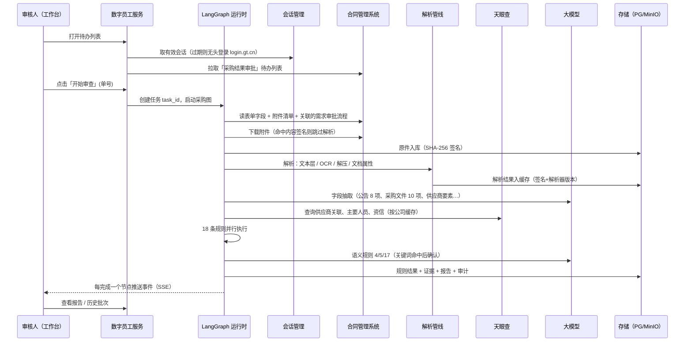

# AI 数字员工项目计划

> 版本：2026-11-06 初稿　｜　状态：讨论中，标注「待定」的条目需确认后再动工

## 1. 项目目标与边界

为客户（通用设计公司）建设 4 个 AI 数字员工：**采购审批、合同审核、三会审查、财务报销初审**。

四个场景性质相同，都是**只读的辅助审查**：

- 从客户系统读取单据表单与附件 → 解析 → 按规则逐条核验 → 输出带证据的报告，交审核人参考。
- **不审批、不改流程、不回写客户系统**（与财务填报工具「只填不提交」同一纪律）。
- 每次运行的数据、过程、结论都要留存，可查看、可回溯。

## 2. 四个场景概览

| 场景 | 客户系统入口 | 规则 | 主要难点 |
|---|---|---|---|
| 采购审批（**首个落地**） | 合同管理系统 → 流程审批 → 待办，搜「采购结果审批」 | 18 条 | 多家供应商材料横向比对（作者/电话/账号雷同、报价等差）；天眼查关联关系 |
| 合同审核 | 合同管理系统 → 待办，搜「主合同审批」 | 30 条 | 语义比对多；天眼查/破产网；投标报价台账取数 |
| 三会审查 | 门户 → 工作 → 公文 → 待办，搜「内部请示」 | 5 个审查节点 | 4 份制度文件检索（权责手册复杂表格），金额档位与审批主体核对 |
| 财务报销 | 门户 → 应用 → 通财云 → 待办任务 | 43 条 / 8 类单据 | 规则最多；发票与扫描件 OCR；通财云需单独打通取数 |

需求原文：`需求场景/` 下 4 份 docx；系统访问路径：`doc/【20261106】四个场景访问路径.docx`；取数样例：`doc/合同取数_demo/`；合同场景额外模块：`doc/合同审核涉及的其他模块.docx`。

### 2.1 客户系统地址

一个统一认证账号（门户账号）即可进入下列所有系统，天眼查为独立账号。

| 系统 | 地址 | 用于 | 状态 |
|---|---|---|---|
| 统一认证 | `https://login.gt.cn/idp/authcenter/ActionAuthChain?entityId=portal` | 所有系统登录 | 已知，.38 可达 |
| 门户（智慧通用） | `https://i.gt.cn/` | 三会（工作 → 公文）、通财云入口 | 已知 |
| 合同管理系统 | `https://contract.gt.cn/spa/...`（勿用 `/wui/index.html`，会落到泛微自带登录页） | 采购、合同；投标报价台账、主合同全条件查询 | 已打通，.38 可达 |
| 公文系统 | 致远 Seeyon `https://oa-xc.gt.cn/seeyon`，经 `/seeyon/tyssj.do` 单点登录 | 三会 | **已打通**（2026-11-09，见 `docs/M0-公文系统取数摸底.md`） |
| 通财云 | 金蝶云苍穹 `https://fc.gt.cn/ierp`（单据 `?formId=…&pkId=…`） | 报销 | **外网被拦截**：重定向到 `/ierp-prompt`「请先连接 VPN」，需本机连 VPN 后摸底 |
| 天眼查 | `https://www.tianyancha.com/` | 采购规则 13–15、合同 R16/R17 | 运营部公用主账号，**已登录验证，会员至 2027-08-28** |
| 破产重整案件信息网 | `https://pccz.court.gov.cn/` | 合同 R17 | 公开网站 |

### 2.2 合同场景需要额外读取的台账

| 规则 | 台账 | 取法 |
|---|---|---|
| R06 联合体分工协议 | 投标管理 → 投标及报价台账 | 按主合同流程【选择投标项目】字段查询，从「项目类型」列链接进入详情，取联合体标前协议 |
| R07 违约责任条款 | 同上 | 台账【附件】字段中的招标文件 |
| R24 中标合同签订时限 | 同上 | 台账【中标证明附件】中的中标通知书日期 |
| R21 合同重复签订 | 主合同管理 → 主合同全条件查询 | 按合同名称、甲方名称相似匹配 |

## 3. 决策记录

| 事项 | 结论 | 状态 |
|---|---|---|
| 技术路线 | Python 自建；编排用 LangGraph | 已定（2026-11-06） |
| 数据与缓存 | **完全独立自建**，不复用 autoagent_flow 的存储、知识库等组件 | 已定（2026-11-06） |
| autoagent_flow 的角色 | 不承载数据；至多作为模型调用通道（可配置，可直连模型） | 待定 |
| 大模型接入 | `digital-employees/config/llm.yaml` 动态加载（改完即生效），支持 Ollama 与 OpenAI 兼容接口；开发期用本机 Ollama（D:\Model）中的 Qwen3-8B | 已接入对话（2026-11-06）；抽取与语义规则待接入 |
| 闲聊策略 | 允许闲聊，保持人设并适时引导回业务（`chat.chitchat: guided`，可改 free / off） | 已定 |
| 首个场景 | 采购审批 | 已定 |
| 登录账号 | 会话获取做成可替换；开发期用测试账号，上线前定专用账号或审核人会话 | 待定 |
| 文件解析由谁做 | 我们自己 OCR，或客户推送解析结果；两种来源都走同一套内容签名缓存 | 待定 |
| 采购规则对应的流程 | 合同系统「采购结果审批流程」(wf=100)，关联「采购关键信息及采购文件确认流程」(wf=790)；审批日志中运营管理部审核岗为徐冉 | 已确认（M0） |
| 合同系统取数方式 | 统一认证登录后接口回放（表单、日志、附件），不渲染页面 | 已打通（M0，见 `docs/M0-合同系统取数摸底.md`） |
| OCR | 已见 PDF 均为扫描件，OCR 为必经环节 | 已确认（M0） |
| 代码分层 | 公共能力进 `core`（运行时、规则框架、制度库、外部查询、取数适配器）；每个场景一个目录 `employees/<场景>`，内部按 取数 → 材料 → 抽取 → 规则 → 报告/对话 分层 | 已定（2026-11-09） |
| 规则状态 | 内部统一一套状态（issue / pass / missing / review / na / notrun / error），各场景按需求文案显示；只有「核查通过」表示无异常 | 已定（2026-11-09） |
| 回写 | 四个场景统一只读，报销也不写入通财云意见框，只在工作台出报告 | 已定（2026-11-09） |
| 报销附件留存 | 沿用内容签名缓存（可回溯、可复用），不采用「解析完即删」 | 已定（2026-11-09） |
| 合同 / 三会用模型 | 沿用 `config/llm.yaml`，开发期本机 Qwen3-8B；合同语义规则失败记「审查中止」；三会严格模式下任一模型失败整单中止 | 已定（2026-11-09） |
| 推进顺序 | 先合同，同时摸底公文系统、通财云，再报销、三会 | 已定（2026-11-09） |
| 本地事项 | 客户系统打通前，三个新场景用 `.runtime/cases/` 下的本地事项（合成样例）端到端联调；本地事项默认不对外查询天眼查 | 已定（2026-11-09） |

## 4. 总体架构

```
┌──────────────────────────── 审核工作台（Web）────────────────────────────┐
│ 待办/报告列表 │ 原文预览 │ 实时审查进度（SSE） │ 结果汇总表 │ 历史批次 │
└──────────────────────────────────┬──────────────────────────────────────┘
                                   │ HTTP / SSE
┌──────────────────────── 数字员工服务（FastAPI）─────────────────────────┐
│ 任务管理 · 事件推送 · 报告查询 · 规则配置                                 │
│ ┌────────────── 运行时（LangGraph，每个数字员工一张图）──────────────┐ │
│ │ 取数节点 → 材料归集 → 解析/抽取 → 外部查询 → 规则并行执行 → 汇总  │ │
│ └────────────────────────────────────────────────────────────────────┘ │
│ 公共能力：会话管理 · 取数适配器 · 解析管线 · 内容签名缓存 · 模型客户端 │
│           外部查询适配器（天眼查等）· 规则引擎 · 审计留痕               │
└───────┬───────────────┬───────────────┬───────────────┬────────────────┘
        │               │               │               │
   PostgreSQL     对象存储(MinIO)     Redis（可选）    大模型服务
  任务/结果/证据   原件/解析产物     会话/锁/短缓存   （直连或经网关）
        ▲
        │ 只读取数（Playwright 登录 + 接口回放）
   客户系统：统一认证 login.gt.cn · 合同管理系统 · 公文 · 通财云 · 天眼查
```

**为什么用 LangGraph 自建而不是放进 autoagent_flow 画布：**

1. 一百多条规则写成代码 + 单测，比画布节点好维护、好回归。
2. 数据要独立维护；如果编排在 flow、数据在我们这边，每个节点都要跨服务调用，排障要两边对日志。
3. 工作台需要「节点级实时进度 + 独立计时 + 证据定位」，自建事件流更直接。
4. 浏览器登录会话需要长期驻留和复用，放在自己的服务里更好管。

autoagent_flow 若保留，只作为模型调用通道（统一管理模型与配额），通过 HTTP 调用；关掉也不影响数字员工运行。

## 5. 端到端流程与调用链（以采购审批为例）



**节点说明：**

| 步骤 | 做什么 | 关键点 |
|---|---|---|
| 1 会话 | 复用已保存的登录态；失效时无头浏览器走一遍统一认证 | 账号密码只放环境变量/密钥文件；会话失效自动重登 |
| 2 待办 | 读取「采购结果审批」待办列表 | 只读，不改变待办状态 |
| 3 归集 | 读表单字段、附件清单、关联的采购需求审批流程（含审批日志） | 规则 1、3、6、17 依赖需求审批信息 |
| 4 下载 | 逐个下载附件，算 SHA-256 | 下载原件（规则 10 需要文档属性中的作者） |
| 5 解析 | Word/Excel 读正文+属性；PDF 先文本层再 OCR；图片 OCR；压缩包解压 | 解析失败不阻断，相关规则记「未能识别」并注明文件 |
| 6 抽取 | 从各类材料抽取结构化要素，强制带原文引用 | 规则 + 大模型（JSON Schema 输出） |
| 7 外部查询 | 天眼查：关联关系、主要人员、失信/破产 | 按公司名缓存，设有效期 |
| 8 规则 | 18 条规则并行，每条输出状态 + 证据 | 结果分「一定不通过 / 拿不准 / 未命中 / 未能识别」 |
| 9 报告 | 汇总、落库、推送 | 报告留存规则版本与生成时间 |

触发方式：一期为审核人在工作台手动点击；「检测到新待办自动生成」作为后续扩展。

## 6. 账号与会话

客户系统没有对外开放接口，所有数据都在统一认证（login.gt.cn）之后，系统按登录人的权限决定能看到哪些流程和附件。账号的用途：

1. **认证**：登录后拿到会话 cookie，之后的每次取数接口都要带它。
2. **授权**：决定能看到哪些单据。待办按人分配，账号必须是流程处理人，或拥有流程查看/监控权限。
3. **留痕**：客户系统会记录是谁读取了单据，账号也是审计主体。

账号**只用于读取**，不做任何审批动作。

**当前测试账号：张建浩**（2026-11-10 起统一使用，此前账号为临时）。目前只开通验证码登录，开发期由人工在调试 Chrome 登录（`cdp` 模式）；开通密码登录后，把账号信息填入 `config/accounts.yaml` 的 `password` 段并切换模式。该账号的可见范围与待办只读约定见 `docs/资料中心与自动化设计.md` 第 11 节。

| 方案 | 优点 | 缺点 |
|---|---|---|
| 数字员工专用账号 + 只读查看权限 | 可无人值守、可批量预生成报告 | 需客户开户并配权限 |
| 审核人点击时用其本人会话 | 权限与人工一致，无需新账号 | 不能无人值守；要接管审核人浏览器 |
| 客户推送数据给我们 | 不需要账号 | 依赖客户开发，周期不可控 |

## 7. 采购审批的取数清单

| 序 | 材料 | 来源 | 形态 | 用于规则 |
|---|---|---|---|---|
| 1 | 采购申请表单字段 | 采购结果审批流程表单 | 结构化 | 1 |
| 2 | 采购需求审批信息 + 审批日志 | 关联的需求审批流程 | 结构化 | 1、3、6、17 |
| 3 | 采购公告 | 附件 | Word/PDF | 2、3、4、5、6、18 |
| 4 | 采购文件 | 附件 | Word/PDF | 7、8、9 |
| 5 | 各供应商响应文件 | 附件，常为压缩包 | Word/PDF/扫描件，可能很大 | 10、11、12 |
| 6 | 评审报告（含谈判报告） | 附件 | Word/PDF | 16、17、18 |
| 7 | 供应商工商信息 | 天眼查网页 | 外部查询 | 13、14、15 |

一笔申请通常 10 份以上文件。取文件只有「下载」一个环节，但**文件多、格式杂、需要识别类型**，是本场景的主要工作量之一。实际附件挂在哪些表单字段、关联流程怎么取，需账号到位后摸底确认。

## 8. 存储与缓存设计（独立自建）

> 详细设计（签名、分层缓存、表结构、统一文档格式、查询接口）见 `docs/文件解析结果缓存与存储设计.md`，以下为摘要。

**组件**：PostgreSQL（结构化数据）+ MinIO（原件与解析产物，也可先用本地目录）+ Redis（可选：会话、分布式锁、短期缓存）。以独立 compose 项目部署，不与 autoagent_flow 共用任何容器或库。

**内容签名缓存**：客户给到我们的每份内容（原始附件或客户推送的解析结果）先算 SHA-256 作为内容签名；缓存键 = 签名 + 处理器版本。缓存记录附 HMAC，读取时校验，防止被篡改。

| 缓存层级 | 键 | 命中后跳过 |
|---|---|---|
| 原件 | SHA-256 | 重复存储 |
| 解析结果 | SHA-256 + 解析器版本 | 文本提取、OCR |
| 抽取结果 | SHA-256 + 抽取提示词版本 + 模型 | 大模型抽取 |
| 外部查询 | 公司名 + 查询类型（带有效期） | 天眼查请求 |
| 整单报告 | 全部材料签名集合 + 规则版本 | 整个审查流程 |

**主要表**：

| 表 | 内容 |
|---|---|
| task | 任务 ID、数字员工、单据标识、触发人、触发时间、状态、规则版本、批次号 |
| material | 任务下的每份材料：文件名、类型、大小、签名、来源字段、读取状态 |
| blob | 签名 → 对象存储路径、MIME、大小 |
| parse_cache / extract_cache | 签名 + 版本 → 结果路径、HMAC、生成时间 |
| external_cache | 查询键 → 结果、有效期 |
| node_run | 节点级执行记录：开始/结束时间、耗时、状态、错误 |
| rule_result | 规则 ID、版本、状态、档位、说明、耗时 |
| evidence | 来源文件、页码/段落、原文片段、对比对象、标准化值 |
| llm_call | 模型、提示词版本、token、耗时、是否命中缓存 |
| report | 任务 → 报告快照 |
| audit_log | 只追加的操作日志 |

## 9. 采购 18 条规则的实现方式

| 类型 | 规则 | 实现 |
|---|---|---|
| 确定性 | 1、3、6、8、9、10、11、12、16、18 | 字段比对、日期计算、金额比较、等差判断、文档属性、关键词 |
| 抽取 + 确定性 | 2、7 | 大模型抽取要素是否存在（带原文引用），再按清单判断缺项 |
| 语义判断 | 4、5、17 | 关键词定位 → 大模型语义确认；误报率目标 ≤ 20% |
| 外部查询 | 13、14、15 | 天眼查网页查询（Playwright + 接口），结果缓存 |

## 10. 技术栈

Python 3.12 · FastAPI · LangGraph · Playwright + httpx · PostgreSQL 16 · MinIO · Redis（可选）
解析：PyMuPDF、python-docx、openpyxl、olefile（老 .doc/.xls 属性）、RapidOCR（CPU）、zipfile/py7zr
前端：React + Vite（工作台）　｜　部署：Docker Compose，目标服务器 10.112.0.38

## 11. 目录结构

代码与文档分开：**所有代码在 `digital-employees/`**，其余为文档与资料。

```
AI数字员工/
├── digital-employees/        ★ 代码根目录
│   ├── core/                 公共底座（不 import 任何 employees）
│   │   ├── runtime.py        运行时：取数客户端与自动重登、节点留痕与实时事件、线性流程图
│   │   ├── materials.py      通用材料节点：下载（按附件版本复用）、并行解析、压缩包展开
│   │   ├── rules/            规则框架：统一状态 status、执行引擎 engine、通用判断 common、语义比对 semantic
│   │   ├── knowledge/        制度库：四份制度 PDF → 条款（权责手册按坐标识别红色最终审批主体）、条款定位与检索
│   │   ├── external/         外部查询：天眼查（页面接口拦截 + 解析）、客户维护的名单
│   │   ├── sources/          取数适配器：contract 合同系统、docflow 公文（均已打通）、fincloud 通财云（待 VPN）、local 本地事项
│   │   ├── llm/              模型客户端 client、结构化判定 judge（JSON + 结果缓存 + 失败显式报错）
│   │   ├── parsing/ storage.py signing.py session.py report.py chat.py cli.py settings.py
│   │   └── api/server.py     工作台后端（按员工注册表路由）
│   ├── employees/
│   │   ├── registry.py       员工注册表（新增员工只需在此登记）
│   │   ├── procurement/      采购审批：18 条规则
│   │   ├── contract/         合同审核：materials / extract / rules（clauses 条款核验、compare 多文件比对、external 外部数据）/ graph / chat / samples
│   │   ├── meeting/          三会审查：materials / extract / checks（5 个审查节点各一个文件）/ prompts / graph / chat / samples
│   │   └── reimburse/        报销初审：model 统一单据模型 / materials / extract / rules（9 类单据各一个文件，共 43 条）/ graph / chat / samples
│   ├── config/               llm.yaml、contract.yaml、meeting.yaml、reimburse.yaml（财务可维护的阈值与词表）、
│   │                         regulations.yaml（制度库登记与启用）、lists/（不合格供应商、标准规范清单）
│   ├── web/                  审核工作台（四位员工）
│   ├── tests/                pytest：底座、制度库（真实 PDF）、三场景端到端与逐条规则、采购离线回归、接口冒烟
│   ├── tools/                摸底与调试脚本（m0_*、portal_probe 门户子系统摸底、make_demo_cases 生成本地样例、ui_*_check）
│   ├── requirements.txt
│   ├── .venv/                虚拟环境（不入库）
│   └── .runtime/             运行产物：存储、缓存、报告、本地事项 cases/、制度解析缓存 knowledge/（不入库）
├── docs/                     设计与摸底文档
├── 需求场景/  doc/  财务数字填报/   资料
├── RPA.md
└── 数字员工项目计划.md
```

后续新增 `deploy/`（compose 与部署脚本）也放在 `digital-employees/` 下。

## 12. 里程碑

| 阶段 | 内容 | 交付 / 验收 |
|---|---|---|
| M0 接口摸底 | 登录、采购结果审批待办、表单字段、附件下载、关联需求流程、天眼查 | **已完成**（2026-11-06）：接口清单；台账 980 条历史单据可作样例/评测集；完整询价样例 1674771 |
| M1 底座 | 会话、取数、解析与签名缓存、存储、任务与事件、审计 | **一期已打通**（2026-11-06）：1674771 端到端跑通；首跑 147 页 OCR 约 5 分钟，再跑全部命中缓存 2.4 s；存储暂用 SQLite（表结构同设计） |
| M2 采购规则 | 18 条规则：先确定性，再语义，最后天眼查 | **进行中**：确定性 11 条已实现（P01–03、06–12、16、18，其中 P06 待接需求流程）；语义 P04/05/17 与天眼查 P13–15 待接入 |
| M3 工作台 | 待办/报告列表、实时进度、结果表、证据定位、历史批次 | 审核人可独立使用 |
| M4 试运行 | 部署 .38，客户内网试用，收集误报/漏报 | 试运行报告 |
| 合同 M2 | 30 条规则（确定性 13、关键词+模型确认 4、多文件语义比对 8、外部数据 5） | **已接通真实单据**（2026-11-09）：主合同审批 wf=99、投标报价台账 customid 86（经 wf=98 取投标附件）、主合同台账 customid 78；1671817（投标）、1609472（监理·非投标）逐条对照原文校准 |
| 三会 M2 | 5 个审查节点 + 四份制度知识库（权责手册 470 行条款全部识别出最终审批主体） | **已接通真实单据**（2026-11-09）：公文系统纯接口取数；通设请字 85/75/76/115 号实测，识别出依据引用旧版事项、条款号与事项名不符等情况 |
| 报销 M2 | 9 类单据 43 条规则（TRV-06 待业务口径、GEN-04 阈值待定） | **已完成**（2026-11-09），逐条单测 + 本地样例端到端通过；通财云需连 VPN 后摸底单据、发票与附件接口 |

工期在 M0 接口摸底后评估。

### 12.1 本地运行（开发期）

```powershell
cd AI数字员工\digital-employees
# 1) 调试 Chrome 中登录门户（会话由人登录，程序只借用）
& "C:\Program Files\Google\Chrome\Application\chrome.exe" --remote-debugging-port=9222 --user-data-dir="$PWD\.runtime\chrome-profile" https://i.gt.cn/
# 2) 启动资料中心（独立进程 :8091；采集、文件与解析结果、执行档案）——工作台与命令行审查都依赖它
#    单进程调试可在 config/resource.yaml 改 mode: inprocess；采集策略见 config/collect.yaml
.venv\Scripts\python.exe -m core.resource.api
.venv\Scripts\python.exe tools\status.py          # 采集轮次、同步队列、资料状态、自动审查
# 2b) 运行采购审批数字员工
.venv\Scripts\python.exe -m employees.procurement.run 1674771
# 3) 生成三个新场景的本地样例（合成数据），并在命令行审查
.venv\Scripts\python.exe tools\make_demo_cases.py
.venv\Scripts\python.exe -m employees.contract.run DEMO-HT-001 --source local
.venv\Scripts\python.exe -m employees.meeting.run DEMO-SH-001 --source local
.venv\Scripts\python.exe -m employees.reimburse.run DEMO-BX-001 --source local
# 4) 工作台：http://127.0.0.1:8090
.venv\Scripts\python.exe -m core.api.server
# 5) 测试（含采购离线回归：用已缓存的 1674771 / 1672706 重放，规则结果须与历史报告逐条一致）
.venv\Scripts\python.exe -m pytest tests -q
# 6) 真实单据审查（调试 Chrome 已登录门户）：合同填单号，三会填内请号（本人已发 / 已办 / 已阅，
#    或「公司数据查询 → 内部请示查询」中流程已结束的请示；未结束的不打开）
.venv\Scripts\python.exe -m employees.contract.run 1609472
.venv\Scripts\python.exe -m employees.meeting.run "通设请字[2026]342号"
# 6c) 三会测试事项：以已结束的真实请示为底稿注入已知问题（REAL-SH-A…E），再跑实网验收
.venv\Scripts\python.exe tools\make_meeting_real_cases.py
.venv\Scripts\python.exe tools\e2e_live_check.py            # 采购 / 合同 / 三会 / 流程与规则 / 采集
# 6d) 清空运行数据重新验证（须先停工作台与资料中心；旧数据整体移入 .runtime\backup\reset-<时间>，保留天眼查缓存）
.venv\Scripts\python.exe tools\reset_runtime.py --yes
# 6b) 客户 OCR 只能内网访问时：本机同构 OCR 服务 + 用客户 OCR 链路对比识别与审查结论
.venv\Scripts\python.exe tools\ocr_local_server.py --backend rapidocr --port 8092
.venv\Scripts\python.exe tools\ocr_compare.py --config config\ocr.local.yaml --limit 8
.venv\Scripts\python.exe tools\ocr_review_check.py --config config\ocr.local.yaml 1674771 1672706
# 7) 摸底工具：公文列表 / 单据取数实测；只读打开已办页面并记录接口（通财云需先连 VPN）
.venv\Scripts\python.exe tools\m0_docflow_list.py 内部请示
.venv\Scripts\python.exe tools\m0_docflow_fetch.py "通设请字[2026]76号" --download
.venv\Scripts\python.exe tools\page_capture.py <名称> <已办单据地址>
```

产物在 `digital-employees/.runtime/`：报告 `reports/<员工>_<单号>_<任务>.md / .json`，工作台库与原件 / 解析结果目录 `store/`，资料中心库 `resource/`，本地事项 `cases/`。

资料中心、采集、客户 OCR、执行档案、自动审查与受限对话的设计与实施状态见 `docs/资料中心与自动化设计.md`。

## 13. 待提供信息

| 序 | 事项 | 阻塞阶段 |
|---|---|---|
| 1 | 统一认证测试账号 + 密码（截图中为刘晖 liuhui60，文档未给密码），及其能看到的采购结果审批单据 | M0 |
| 2 | 10–20 份历史采购结果审批单号 + 审核人结论（含有问题/无问题） | M2 |
| 3 | 天眼查账号 | 已提供（2026-11-06） |
| 4 | 大模型选型；采购/合同数据是否允许发往外部接口 | M2 |
| 5 | 采购 18 条规则是否对应合同系统「采购结果审批流程」 | M0 |
| 6 | 上线账号方案（专用账号 / 审核人会话） | M4 |
| 7 | 文件解析由我们做还是客户推送 | M1 |
| 8 | 其他场景业务对接人；`doc/邮箱-接收周报.docx` 名单是否为周报接收人 | 后续 |
| 9 | 合同：几笔已归档的主合同审批单号（最好含联合体总承包、框架/战略协议、监理/项目管理各一笔） | 合同联调 |
| 10 | 合同：不合格供应商名单（`config/lists/unqualified_suppliers.yaml`）、标准规范有效/失效清单（`config/lists/standards.yaml`）、人员所属部门数据来源（R22） | 合同 R17 / R29 / R22 |
| 11 | 报销：TRV-06 判定口径、GEN-04 长期/临时租车分界、办公费负面清单内容、职级与审批身份映射、央企名录确认（均在 `config/reimburse.yaml`） | 报销上线 |
| 12 | 三会 / 报销：测试账号公文、通财云待办为 0，需确认可用于联调的已办单据（三会已改用「公司数据查询 → 内部请示查询」中已结束的请示联调；报销仍待确认） | 报销联调 |
| 13 | 三会：OA 同一账号只允许一处在线，程序单点登录会把调试 Chrome 里的 OA 页面挤下线（门户不受影响）；上线前确认是否给数字员工专用账号 | 三会上线 |

## 14. 主要风险

| 风险 | 应对 |
|---|---|
| 客户系统改版导致取数失效 | 取数走接口回放、少依赖页面元素；适配器集中维护；定期冒烟 |
| 会话失效 / 登录策略变化（验证码、短信） | 自动重登 + 失败告警；必要时切换审核人会话方案 |
| 扫描件识别率低 | 任何一份文件未识别都单独列出，交人工核对 |
| 语义规则误报高 | 关键词 + 语义确认；用样例单据统计误报率，超 20% 收紧 |
| 响应文件过大拖慢任务 | 限制解压层数与总大小；大文件分页解析；按需抽取 |
| 外部查询受限（天眼查频次） | 按公司缓存 + 限速；失败标记「未能识别」不当通过 |
